<picture>
  <source media="(prefers-color-scheme: dark)" srcset="./dark.svg">
  <source media="(prefers-color-scheme: light)" srcset="./light.svg">
  
</picture>

## Despre mine

Sunt absolvent al Facultății de Inginerie Electrică și Știința Calculatoarelor din cadrul Universității „Ștefan cel Mare" din Suceava, specializarea Calculatoare (2021–2025). Mă interesează sistemele IoT, automatizările pentru locuință și dezvoltarea de aplicații în Python, C++ și C#.

## Studii

- **Universitatea „Ștefan cel Mare" din Suceava** – Facultatea de Inginerie Electrică și Știința Calculatoarelor, specializarea Calculatoare, 2021–2025

## Proiecte

| Proiect | Descriere | Limbaj |
|---|---|---|
| [Lucrare de licență – SenzorVital](https://github.com/dovahkiin124/Lucrare_de_Licenta_SenzorVital) | Arhitectură multi-senzor cu analiză în timp real: ESP8266 și ESP32-C3 cu firmware Tasmota, comunicare MQTT și integrare cu Home Assistant | Markdown |
| [Magazin_online_de_telefoane_mobile](https://github.com/dovahkiin124/Magazin_online_de_telefoane_mobile) | Magazin online de telefoane mobile | C# |
| [System-security](https://github.com/dovahkiin124/System-security) | Proiect de securitate a sistemelor | C++ |
| [Youtube_Downloader](https://github.com/dovahkiin124/Youtube_Downloader) | Program care descarcă conținut video de pe YouTube | Python |
| [Music_Downloader](https://github.com/dovahkiin124/Music_Downloader) | Versiune a programului anterior, care descarcă fișiere audio | Python |
| [Jocul-snake](https://github.com/dovahkiin124/Jocul-snake) | Jocul Snake | Python |
| [Jocul-Tetris](https://github.com/dovahkiin124/Jocul-Tetris) | Jocul Tetris | Python |

## Tehnologii

## Contact

